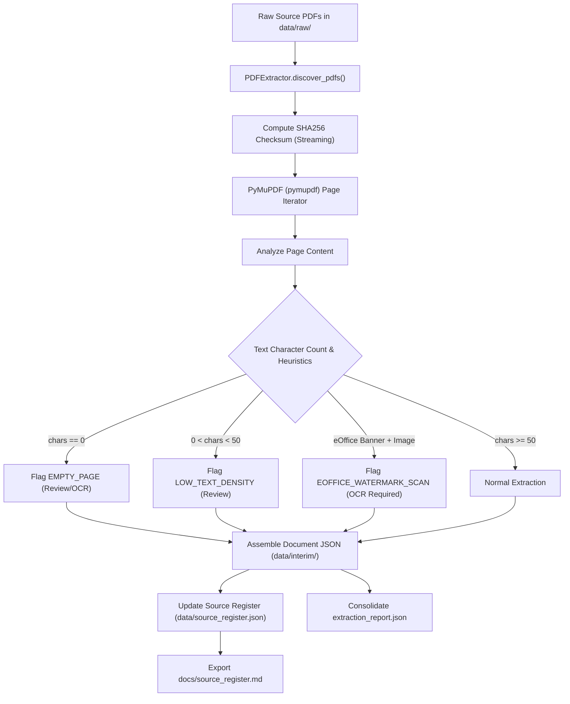

# SIH26101 — Official Statistics Competency Intelligence and Adaptive Learning Platform

> **Stage 1: Project Foundation and PDF Ingestion**  
> An auditable, reproducible data foundation for India's Official Statistical System.

---

## 1. Project Background

India's official statistical system—anchored by the **Ministry of Statistics and Programme Implementation (MoSPI)**, the **National Statistical Office (NSO)**, the **National Statistical Systems Training Academy (NSSTA)**, and civil service capacity initiatives under **Mission Karmayogi**—requires a structured competency intelligence platform.

Eventually, the system will support:
- Role- and competency-based skill-gap analysis for statistical cadres (Indian Statistical Service - ISS, Subordinate Statistical Service - SSS).
- Adaptive competency assessments and diagnostic testing.
- Personalized learning recommendations mapped to iGOT Karmayogi and NSSTA calendar courses.
- Source-grounded Q&A and question generation based on official statistical standards (such as *National Accounts Statistics: Sources and Methods*).
- Learner and administrator dashboards.

**Stage 1 Scope:** Establishing the data foundation, source provenance register, and a resilient, reproducible PDF text-extraction pipeline.

---

## 2. Directory Architecture

```text
SIH26101-Skill-Intelligence/
├── data/
│   ├── raw/                  # Read-only source PDFs (strictly immutable)
│   ├── interim/              # Page-by-page JSON extractions & extraction reports
│   │   ├── <source_id>.json  # Page-level text, character counts, and OCR flags
│   │   └── extraction_report.json # Consolidated machine-readable batch report
│   ├── processed/            # Structured, validated competency dictionaries
│   │   ├── competencies_kcm.json # 34 official KCM competencies (JSON)
│   │   └── competencies_kcm.csv  # 34 official KCM competencies (CSV)
│   ├── synthetic/            # Reserved for Stage 2+: Benchmarking & synthetic items
│   └── source_register.json  # Authoritative source register with SHA256 checksums
├── docs/
│   ├── source_register.md    # Human-readable markdown catalog of source publications
│   └── kcm_extraction_notes.md # KCM extraction analysis, layout anomalies & review report
├── scripts/
│   ├── pdf_extractor.py      # Core extraction engine with PyMuPDF & OCR quality heuristics
│   ├── source_register.py    # Schema validator & register synchronization engine
│   ├── extract_text.py       # Batch extraction runner for raw PDFs
│   └── extract_kcm.py        # Stage 2A: KCM Competency Extraction Pipeline
├── tests/
│   ├── test_pdf_extractor.py # Unit & integration tests for extraction & edge cases
│   ├── test_source_register.py # Tests for schema validation & provenance rules
│   └── test_kcm_extraction.py # Tests for KCM competency dataset & field integrity
├── requirements.txt          # Pinned runtime dependencies
├── AGENTS.md                 # Operating constraints for AI pair-programming agents
├── README.md                 # Complete system documentation
└── .gitignore                # Environment, cache, and OS ignore rules
```

---

## 3. Environment & Prerequisites

- **Python Version:** Python `>=3.10` (Tested and validated on Python 3.14.4).
- **Operating System:** Windows, Linux, or macOS.

### Installation

1. **Clone or navigate to the workspace directory:**
   ```bash
   cd SIH26101-Skill-Intelligence
   ```

2. **Create and activate a Python virtual environment (recommended):**
   ```bash
   python -m venv .venv
   # Windows PowerShell:
   .venv\Scripts\Activate.ps1
   # Linux/macOS:
   source .venv/bin/activate
   ```

3. **Install dependencies:**
   ```bash
   pip install -r requirements.txt
   ```

---

## 4. How to Run

### Run the PDF Extraction Pipeline (Stage 1)
To discover PDFs in `data/raw/`, extract text page-by-page, detect OCR candidates, update the source register, and write extraction reports:
```bash
python scripts/extract_text.py
```

### Run KCM Competency Extraction (Stage 2A)
To extract structured Behavioural and Functional competencies, descriptions, and behaviours from the Karmayogi Competency Model PDF:
```bash
python scripts/extract_kcm.py
```

### Run MoSPI ACBP OCR & Table Extraction (Stage 2B.1)
To perform 200 DPI OCR, table grid segmentation, and uncertainty-flagged extraction on the scanned MoSPI Annual Capacity Building Plan (ACBP):
```bash
python scripts/extract_acbp_ocr.py
```

### Run ACBP Dataset Structuring & Reconciliation (Stage 2B.2)
To structure 226 courses across 11 cadres, 30 nodal officers, preserve uncertainty flags without guessing, and reconcile candidate KCM mappings:
```bash
python scripts/structure_acbp.py
```

### Run the Automated Test Suite
To execute the automated test suite verifying extraction fidelity, error resilience, empty page detection, source schema, KCM competency integrity, and ACBP OCR table recovery:
```bash
python -m pytest -v
```

---

## 5. Output Locations & Artifacts

| Output Path | Description |
| :--- | :--- |
| `data/processed/acbp_courses.json` | Authoritative structured catalog of 226 ACBP training courses across 11 cadres with preserved raw OCR values, uncertainty flags, and review notes. |
| `data/processed/acbp_courses.csv` | Tabular CSV export of all 226 structured ACBP course records. |
| `data/processed/acbp_nodal_officers.json` | Authoritative structured directory of all 30 MoSPI division nodal officers (Annexure II) with contact audits. |
| `data/processed/acbp_nodal_officers.csv` | Tabular CSV export of all 30 division nodal officers. |
| `data/processed/acbp_kcm_candidate_mappings.json` | Conservative non-fabricated mapping ledger evaluating all 226 courses against 34 KCM competencies (6 explicit, 220 unresolved). |
| `docs/acbp_data_dictionary.md` | Formal data dictionary and schema specification for all Stage 2B.2 processed datasets. |
| `docs/acbp_reconciliation_report.md` | Comprehensive source audit ledger detailing cadre distributions, recurring courses, itemized uncertainties, and readiness assessment. |
| `data/interim/SRC-MOSPI-ACBP-2026-27_ocr.json` | Full page-by-page dual extraction (native watermark + EasyOCR 200 DPI) for all 13 ACBP pages with cell confidence and uncertainty flags. |
| `data/interim/SRC-MOSPI-ACBP-2026-27_tables.json` | Clean machine-readable catalog of 226 recovered courses across 11 cadres and 30 division nodal officers. |
| `data/interim/SRC-MOSPI-ACBP-2026-27_tables.csv` | Tabular CSV export of all recovered cadre training courses. |
| `data/interim/SRC-MOSPI-ACBP-2026-27_nodal_officers.csv` | Tabular CSV export of all 30 division nodal officers (Annexure II). |
| `data/source_register.json` | Authoritative JSON catalog containing document IDs, original filenames, issuing bodies, SHA256 checksums, and extraction stats. |
| `docs/source_register.md` | Formatted Markdown source catalog for human inspection and documentation. |
| `docs/acbp_ocr_quality_report.md` | Comprehensive Stage 2B.1 quality audit report documenting OCR engine verification, table recovery methodology, manual review items, and release readiness. |

---

## 6. How the Pipeline Works



### Key Heuristics for OCR Review:
1. **Empty Pages (`EMPTY_PAGE`):** Pages with 0 characters. If images are present (e.g. Page 1 of `Circular_NSSTA_Advance_Training_Calander_FY(25-26).pdf`), it is an un-OCR'd scanned cover letter. If no images are present, it is a blank separator page.
2. **Low Text Density (`LOW_TEXT_DENSITY`):** Pages with fewer than 50 characters, often representing graphic section headers or decorative title pages (e.g. `KCM-Output_RestructuredOct17.pdf` Page 37: "Annexures").
3. **eOffice Watermark Scans (`EOFFICE_WATERMARK_SCAN`):** Identified in `OM -Annual Capacity Building Plan (ACBP) for MoSPI officials employees for FY 2026–27.pdf`, where an automated eOffice header (File No., Computer No.) is the only digital text (~256 characters) overlaid on top of a full-page scanned image.

---

## 7. Inspection of Flagged Pages

To review pages flagged by the pipeline:
1. Open `data/interim/extraction_report.json` and examine the `"ocr_review_details"` array.
2. Inspect the specific page number in the source PDF in `data/raw/`.
3. Check the reason provided in the JSON report:
   - **Scanned Letters:** (e.g., Circular Page 1) Contains tabular or narrative text trapped inside an image. Needs OCR in Stage 2.
   - **Scanned Office Memorandums:** (e.g., ACBP Pages 1–13) Contains scanned matrices of training targets. Needs OCR in Stage 2.
   - **Blank / Spacer Pages:** (e.g., Annual Report Page 3) Can be marked as empty divider pages; no OCR needed.

---

## 8. Defending Major Implementation Decisions

1. **Why PyMuPDF (`pymupdf`)?**
   PyMuPDF provides high-performance, deterministic C-level text and image boundary extraction with native UTF-8 support. Unlike pure-Python alternatives, it handles complex PDF layouts, multi-column tables, font encodings, and Unicode characters without truncation.
2. **Why flag OCR rather than automatically running OCR now?**
   OCR is resource-intensive, introduces non-deterministic spelling errors, and requires specialized engines (such as Tesseract or Vision models) with pre-processing (deskewing, binarization). By separating extraction from OCR, we preserve pure digital text where available and isolate scanned pages for targeted, verifiable OCR in Stage 2.
3. **Why compute SHA256 checksums?**
   Government publications and circulars are frequently updated or re-uploaded. Computing a SHA256 hash at ingestion creates an immutable cryptographic fingerprint, ensuring that any upstream change to the raw file is immediately detectable.
4. **Why maintain both JSON and Markdown source registers?**
   The JSON register provides a machine-readable schema for automated validation and CI/CD pipelines, while the Markdown document provides an accessible reference for auditors and evaluators.

---

## 9. Deliberately Deferred (Future Stages)

To maintain modularity and educational clarity, the following components are **deliberately not implemented in Stage 1**:
- **OCR Engine (Tesseract/PaddleOCR):** Deferred to Stage 2 for flagged pages.
- **Competency Extraction & NLP Parsing:** Competency dictionaries, skill levels, and role definitions will be extracted in Stage 2.
- **Database / Storage Backends:** PostgreSQL / vector databases (Chroma, pgvector) are deferred to subsequent stages.
- **Web Interface & APIs:** FastAPI and frontend dashboards will be built once data modeling is established.
