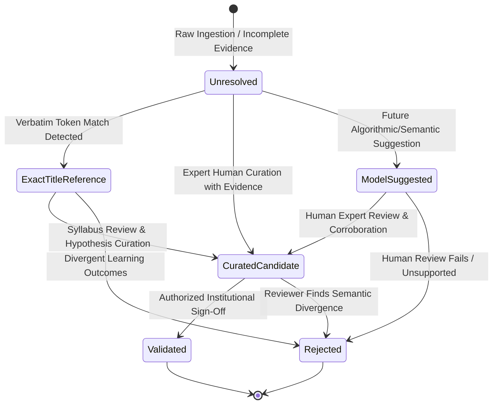
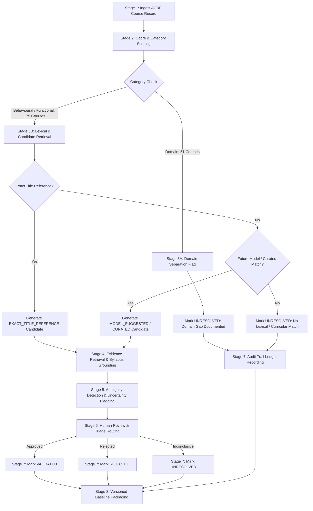
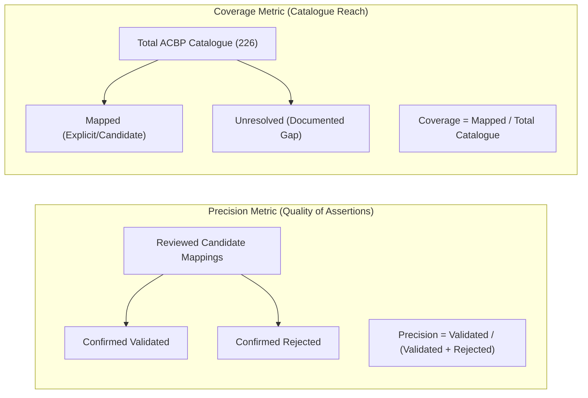

# Competency Mapping Framework: Architecture, Lifecycle, & Governance

> **Document Status:** Architectural Specification  
> **Milestone:** SIH26101 — Stage 3.1: Design the Competency Mapping Framework  
> **Source Documents:**  
> - Capacity Building Commission: *Karmayogi Competency Model (KCM)* (`SRC-CBC-KCM-2024`)  
> - Ministry of Statistics and Programme Implementation: *Annual Capacity Building Plan (ACBP) FY 2026–27* (`SRC-MOSPI-ACBP-2026-27`)  
> **Author:** Antigravity AI & SIH26101 Engineering Team  
> **Release Target:** Stage 3.1 Design Baseline  

---

## 1. Executive Summary & Core Mandate

The primary objective of **Stage 3.1** is to establish an auditable, transparent, and methodologically conservative framework connecting India's **Mission Karmayogi Competency Model (KCM)** with the training curriculum established in the **MoSPI Annual Capacity Building Plan (ACBP) FY 2026–27**.

Connecting civil service competency frameworks with operational ministerial training plans is fraught with risks of **heuristic drift** and **algorithmic hallucination**:
1. **The Superficial Similarity Trap:** Many course titles contain words that mimic competency names (e.g., *"Leadership in Project Management"* vs. KCM's *"Project Management"* or *"Strategic Leadership"*), yet their actual learning outcomes, target cadre depths, and assessment criteria may differ significantly.
2. **The "Domain Vacuum" Reality:** The CBC Karmayogi Competency Model defines **13 Behavioural** and **21 Functional** competencies common across all civil services. It intentionally **does not define MoSPI-specific Domain competencies** (e.g., Survey Methodology, National Accounts Statistics, Index Numbers, Sample Registration Systems). MoSPI's ACBP, conversely, designates **51 of its 226 course allocations as `Domain`**. Attempting to force every MoSPI training course into a KCM bucket would introduce false mappings.
3. **The Auditability Mandate:** Every competency linkage used for national capacity building, officer training trajectories, and institutional learning audits under the National Programme for Civil Services Capacity Building (NPCSCB) must be supported by verifiable provenance.

To satisfy these imperatives, this framework establishes a **conservative mapping methodology** where **unresolved relationships are treated as a defensible and correct outcome** when evidence is incomplete, rather than an error to be eliminated through forced guessing.

---

## 2. Taxonomy of Mapping Concepts (Step 1)

The relationship between a MoSPI ACBP course and a KCM competency cannot be captured by a simplistic binary link. This framework defines **six distinct, non-interchangeable mapping concepts**, establishing strict semantic boundaries for each:

### 2.1 The Six Canonical Mapping Concepts

| Mapping Concept | Formal Definition | Permissible Evidence Base | Permissible Author / Source |
| :--- | :--- | :--- | :--- |
| **1. Source-Stated Relationship** (`source_stated`) | The relationship is explicitly asserted within the official text of a single government source document (e.g., an ACBP course syllabus explicitly declaring *"This course addresses KCM Competency KCM-FUNC-05"*). | Verbatim text citation from source document page and paragraph. | Issuing Government Authority (MoSPI, NSSTA, CBC). |
| **2. Exact Title Reference** (`exact_title_reference`) | The title of the course contains a verbatim or exact syntactic match of a canonical KCM competency name, but the underlying syllabus, learning outcomes, and assessment scope have not yet been verified against KCM sub-themes. | Lexical token containment in verified course title string. | Deterministic Lexical Extraction Pipeline. |
| **3. Curated Candidate Mapping** (`curated_candidate`) | A trained human analyst or subject matter expert proposes a mapping based on structured inspection of course descriptions, provider profiles, target cadre levels, and KCM sub-theme behavioral indicators. | Documented curricular rationale citing specific KCM sub-themes and course objectives. | Qualified Human Domain Analyst / Curriculum Reviewer. |
| **4. Model-Suggested Mapping** (`model_suggested`) | An automated computational method (e.g., dense vector cosine similarity, cross-encoder scoring, or LLM-assisted evaluation) suggests a probable link. Strictly non-authoritative. | Quantitative similarity metric, score distribution, and model-extracted rationale snippet. | Future ML Pipeline / Algorithmic Engine. |
| **5. Validated Mapping** (`validated`) | An authorized review authority confirms that the course curriculum, pedagogical depth, and target cadre align with the KCM competency definition and sub-theme indicators. | Multi-point curricular audit signed off by designated authority with formal review ledger. | Authorized Institutional Review Board (MoSPI Nodal Officer, NSSTA Faculty, or CBC Reviewer). |
| **6. Unresolved Relationship** (`unresolved`) | Available source evidence is insufficient, ambiguous, contradictory, or absent (such as domain-specific statistical courses with no KCM counterpart). Preserved as unresolved to prevent false classification. | Documented statement of evidence absence, domain mismatch, or unresolved ambiguity. | Pipeline Ingestion Engine or Human Reviewer. |

---

### 2.2 Status Transition Lifecycle & Authorization Matrix

A mapping record must never transition between states arbitrarily. Every transition requires a documented trigger, verified evidence, and an authorized actor:

| Current Status | Permitted Next Status | Required Trigger | Authorized Actor | Required Evidence & Invariant Check |
| :--- | :--- | :--- | :--- | :--- |
| `unresolved` | `exact_title_reference` | Verbatim KCM title string match detected during deterministic lexical scan. | Ingestion Pipeline / Analyst | Course title contains exact canonical KCM competency name. Confidence strictly `null` (no fabricated float). |
| `unresolved` | `curated_candidate` | Human domain expert analyzes course description and identifies verifiable alignment. | Domain Analyst / NSSTA SME | Formal rationale citing at least one specific KCM sub-theme from `competencies_kcm.json`. |
| `unresolved` | `model_suggested` | Future semantic retrieval model scores course against KCM above pre-calibrated threshold. | Machine Inference Pipeline | Similarity metric recorded; model version logged; status remains unapproved. |
| `exact_title_reference` | `curated_candidate` | Analyst verifies that the title reference corresponds to genuine curricular coverage. | Domain Analyst / Curriculum SME | Written confirmation that course scope matches competency definition. |
| `exact_title_reference` | `rejected` | Review of course syllabus reveals title is purely metaphorical or unrelated to KCM scope. | Domain Analyst / Reviewer | Review note detailing why the lexical match is spurious or misleading. |
| `model_suggested` | `curated_candidate` | Human expert reviews model suggestion and adopts it with verified evidence. | Domain Analyst | Expert independently validates evidence and replaces model rationale with human rationale. |
| `model_suggested` | `rejected` | Human reviewer rejects algorithmic suggestion due to semantic mismatch. | Domain Analyst | Rejection reason logged; audit trail preserved without record deletion. |
| `curated_candidate` | `validated` | Formal sign-off by institutional capacity building authority. | Authorized Review Board (MoSPI/CBC) | Sign-off metadata recorded (`reviewer_id`, `timestamp`, `institutional_role`). |
| `curated_candidate` | `rejected` | Review board determines course does not sufficiently cover competency indicators. | Authorized Review Board | Detailed audit directive explaining why curricular evidence is deficient. |
| `curated_candidate` | `unresolved` | Evidence is deemed inconclusive pending acquisition of full iGOT syllabus. | Authorized Review Board | Flagged as pending external syllabus acquisition. |

> [!CRITICAL]
> **Strict Operational Invariants:**
> 1. Under **no circumstances** may a `model_suggested` mapping transition directly to `validated` without intermediate human curation and formal sign-off.
> 2. No automated script or contributor may silently promote a `curated_candidate` or `exact_title_reference` to `validated`.
> 3. Records marked `rejected` or `unresolved` must **never be deleted**; they form the permanent negative-example audit trail required to assess pipeline precision.

---

## 3. End-to-End Conservative Mapping Workflow (Step 4)

To process the complete catalogue of **226 MoSPI ACBP courses** without introducing heuristic distortion, the workflow executes across eight reproducible stages:

### Stage 1: Preserve the Source Course Record
Every course record from `data/processed/acbp_courses.json` (`ACBP-CRS-001` through `ACBP-CRS-226`) is treated as an immutable unit of evaluation. The course record's `record_id`, `cadre_role`, `course_name`, `competency_category`, `duration`, `course_creator`, `source_page`, and `source_row` are locked into the mapping record.

### Stage 2: Cadre and Category Scoping
The ACBP organizes training by cadre hierarchy (from *MTS/Driver* up to *DDG/Joint Secretary Equivalent*) and curricular category (`Domain`, `Functional`, `Behavioural`). Scoping evaluates whether the course falls within the structural domain of the KCM:
- **`Behavioural` (96 courses):** Candidate pool restricted to KCM Behavioural competencies (`KCM-BEH-01` to `KCM-BEH-13`).
- **`Functional` (79 courses):** Candidate pool restricted to KCM Functional competencies (`KCM-FUNC-01` to `KCM-FUNC-21`).
- **`Domain` (51 courses):** KCM contains zero domain competencies. These are immediately routed to Stage 3A.

### Stage 3: Candidate Link Generation & Separation
1. **Domain Course Separation (Stage 3A):** The 51 Domain courses are marked `unresolved` with explicit rationale: *"Course belongs to MoSPI Domain category (Official Statistics, Survey Methodology, National Accounts, Big Data). KCM contains zero Domain competencies; requires NSSTA/MoSPI domain competency dictionary."* This prevents 51 false mappings.
2. **Deterministic Lexical Screening (Stage 3B):** Evaluates exact token matches between normalized course titles and canonical KCM titles.
3. **Curated & Future Model Retrieval (Stage 3C):** For non-exact titles, lexical and semantic candidates may be proposed, tagged strictly as `model_suggested`.

### Stage 4: Evidence Retrieval & Syllabus Grounding
For any candidate mapping, the pipeline retrieves:
- The exact KCM definition text from `competencies_kcm.json`.
- The specific KCM sub-themes and behavioral indicators (e.g., p. 75 for `Project Management`).
- The verbatim course title, creator (e.g., `CBC`, `DoPT`, `IIT Kanpur`), and cadre context from `acbp_courses.json`.
- If an official course syllabus or module outline becomes available, relevant excerpt text is attached.

### Stage 5: Ambiguity Detection & Uncertainty Flagging
The candidate record is audited for specific uncertainty triggers:
- **Title Polysemy:** Words like *"Inquiry"*, *"Policy"*, *"Appraisal"*, or *"Governance"* that could map to multiple competencies.
- **Compound Modules:** Courses covering multiple domains (e.g., *"Data Analytics and Visualizations"*).
- **OCR Anomaly Inheritance:** If the parent course record has `is_uncertain: true` in `acbp_courses.json` (such as mangled course names or OCR punctuation specks), the uncertainty flag is inherited.
- **Audience Mismatch:** A high-level strategic competency mapped to a clerical cadre course, or vice versa.

### Stage 6: Human Review & Triage Routing
Candidate records are routed to domain reviewers based on cadre and category:
- Behavioural courses with Indic themes (*Sadharanikarana*, *Rajadharma*, *Seva-Bhava*) routed to CBC/Karmayogi cultural framework reviewers.
- Functional courses (*CSMOP*, *Parliamentary Questions*, *Disciplinary Proceedings*) routed to Central Secretariat administration experts.
- Flagged records require mandatory two-reviewer consensus before promotion.

### Stage 7: Auditable Decision Recording
The reviewer's adjudication (Approval, Revision, or Rejection) is recorded directly in the mapping schema:
- The reviewer's identifier and timestamp are sealed.
- Detailed rationale is appended.
- No rejected record is discarded; rejections are stored with validation status `rejected` and detailed critique.

### Stage 8: Versioned Baseline Packaging
The resulting dataset is serialized to `data/processed/acbp_kcm_mappings.json` with full cryptographic hashes of input datasets (`SRC-CBC-KCM-2024` and `SRC-MOSPI-ACBP-2026-27`), pipeline versioning, and summary audit registers.

---

## 4. Role and Boundaries of Future Computational Techniques

While Stage 3.1 is strictly a design and analysis milestone, future stages may introduce computational assistance. This framework defines their operational boundaries:

### 4.1 Lexical & Syntactic Matching (Stage 3.2+)
- **Techniques:** Token n-gram overlap, BM25 indexing over KCM definitions, lemmatized keyword extraction.
- **Role:** High-recall discovery of potential lexical overlap.
- **Boundaries:** Lexical match alone **never confers validation**. It can only produce `exact_title_reference` or `model_suggested` records.

### 4.2 Dense Semantic Embeddings (Stage 3.3+)
- **Techniques:** Domain-fine-tuned bi-encoders (e.g., BGE, MiniLM, or Indian-administrative fine-tunes) computing cosine similarity between course metadata and KCM sub-theme text.
- **Role:** Retrieval of non-verbatim matches (e.g., linking *"Conduct of Inquiry in Disciplinary Matters"* to *KCM-FUNC-21 Administration Matters* or *KCM-FUNC-19 Vigilance Administration*).
- **Boundaries:** Cosine similarity scores must be interpreted as **relative retrieval rankings**, not absolute probabilities of competency coverage. A similarity of `0.88` means the text vectors are close in geometric space, not that the course teaches 88% of the competency.

### 4.3 LLM-Assisted Reviewer (Stage 3.4+)
- **Techniques:** Prompted large language models performing structured evidence extraction, comparing full course syllabi against KCM behavioral indicators.
- **Role:** Drafting candidate rationales, identifying missing evidence, and highlighting subtle cadre-level misalignments for human review.
- **Boundaries:** LLM outputs must be schema-constrained, require citation of exact KCM text excerpts, and **can never have approval authority**. The LLM operates strictly as an assistant to the human reviewer.

---

## 5. Strict Negative Constraints & Guardrails

To preserve adherence to `AGENTS.md` and Mission Karmayogi guidelines, the following practices are **expressly prohibited**:

1. **No Forced 100% Coverage:** Under no circumstances should the system attempt to force all 226 courses into KCM competencies. Mappings must only be established where defensible evidence exists.
2. **No Competency Level Inference:** The KCM baseline explicitly leaves competency levels (Levels 1–5) unassigned (`level_information = null`). No pipeline component may invent or infer a proficiency level (e.g., assuming a 45-minute course provides "Level 1" or a Joint Secretary course provides "Level 5").
3. **No Duration-Based Difficulty Attribution:** Course duration reflects video/lecture runtime (e.g., `00:46:21`), not pedagogical mastery or cognitive complexity.
4. **No Fabricated Confidence Scores:** Numeric confidence scores (e.g., `0.85`, `0.90`) must not be assigned based on subjective heuristics. If confidence is reported, its mathematical calculation must be formally defined and grounded in evaluated validation data.
5. **No Cross-Ministry Hallucination:** Courses referencing external initiatives (e.g., `PM Gatishakti`, `GeM for Buyers`, `Bhashini`) must not be mapped to unrelated KCM functional competencies simply because both mention "projects" or "technology".

---

## 6. Evaluation Framework & Quality Metrics (Step 5)

Before scaling mapping pipelines to hundreds or thousands of government courses, the mapping framework must be benchmarked against rigorous evaluation criteria. 

> [!IMPORTANT]
> In accordance with repository rules, **no evaluation scores or performance metrics may be reported without reviewed ground-truth labels**. The metrics below define the mathematical framework for future benchmark execution.

### 6.1 Core Metric Definitions

#### 1. Precision Among Human-Reviewed Mappings ($P_{rev}$)
Measures the proportion of proposed candidate mappings accepted as genuinely valid by authorized institutional reviewers:
$$P_{rev} = \frac{N_{validated}}{N_{validated} + N_{rejected}}$$
- Target: $\ge 90\%$ among human-reviewed candidates.

#### 2. Inter-Rater Reliability ($\kappa$)
Measures agreement between independent human reviewers using Cohen's Kappa ($\kappa$) for two raters or Fleiss' Kappa for multiple raters:
$$\kappa = \frac{P_o - P_e}{1 - P_e}$$
Where $P_o$ is observed agreement and $P_e$ is chance agreement across mapping decisions (`Approve`, `Revise`, `Reject`).
- Target: $\kappa \ge 0.75$ (substantial agreement).

#### 3. Unsupported-Mapping Rate ($R_{unsup}$)
Measures the fraction of candidate mappings where the cited evidence fails to reference specific text in the source document or KCM sub-themes:
$$R_{unsup} = \frac{N_{candidates\ without\ direct\ text\ citation}}{N_{total\ candidates}}$$
- Target: Strictly $0.0\%$. Every candidate must provide verifiable textual citations.

#### 4. Coverage Decoupling ($C$)
Coverage must **always be reported separately from precision**. Reporting high coverage achieved by forcing dubious mappings degrades platform trust:
$$C_{total} = \frac{N_{mapped}}{N_{catalogue}} \quad \text{vs.} \quad C_{category} = \frac{N_{mapped\_in\_category}}{N_{total\_in\_category}}$$
Expected structural profile:
- Behavioural Coverage: Moderate to High (60–85%) due to direct KCM behavioural alignment.
- Functional Coverage: Moderate (30–60%) due to overlap in administrative subjects (CSMOP, RTI, Procurement).
- Domain Coverage: Strictly **0.0%** against KCM, pending integration of a dedicated MoSPI/NSSTA Domain Dictionary.

#### 5. Evidence Traceability Index ($I_{trace}$)
The percentage of mapping records that provide verifiable, 1-indexed source document identifiers, page numbers, and row keys for both the course and the competency:
$$I_{trace} = \frac{N_{fully\_traceable\_records}}{N_{total\_records}} \times 100\%$$
- Target: $100.0\%$.

#### 6. Unresolved / Rejection Distribution Analysis
Monitors the distribution of unresolved records across cadres and categories to detect systemic blind spots in capacity-building frameworks.

---

## 7. Cadre-Specific and Curricular Category Analysis

The ACBP catalogue exhibits stark structural variation across its 11 cadre levels and 3 curricular categories:

| Curricular Category | Total Courses in ACBP | KCM Counterpart Availability | Anticipated Mapping Feasibility | Primary Methodological Hazard |
| :--- | :---: | :--- | :--- | :--- |
| **Domain** | **51** | **None** (KCM covers only cross-cutting competencies) | **0% against KCM** (Unresolved by design) | **Forced Categorization:** Attempting to force statistical courses (*Index Numbers*, *Sampling*) into generic KCM buckets. |
| **Functional** | **79** | **21 Competencies** (Procurement, RTI, Litigation, Parliamentary Matters, Office Management) | **Moderate (35–65%)** | **Equivocation:** Confusing broad functional topics (e.g. general digital tools) with specific administrative competencies (CSMOP). |
| **Behavioural** | **96** | **13 Competencies** (Collaboration, Strategic Leadership, Communication, Ethics, Empathy) | **High (60–80%)** | **Philosophical Over-Extension:** Assuming Indic cultural courses (*Rajadharma*, *Bhagavad Gita*) map directly to westernized behavioral constructs without granular sub-theme analysis. |
| **TOTAL** | **226** | **34 KCM Competencies** | **Catalogue Average: 35–50%** | **Heuristic Hallucination.** |

---

## 8. Summary of Methodological Decisions

1. **Explicit Separation of Concepts:** The six mapping concepts are structurally segregated in the schema, preventing conflation of lexical similarity with curricular mastery.
2. **First-Class Unresolved State:** Unresolved courses are treated as valid, audited outcomes that reflect genuine gaps in national competency models.
3. **Audit Trail Immutability:** Candidate reviews and rejections are permanently ledgered, creating the essential negative dataset required for future ML training.
4. **Zero Level Fabrication:** Competency levels remain unassigned, faithfully mirroring the official source publications.
