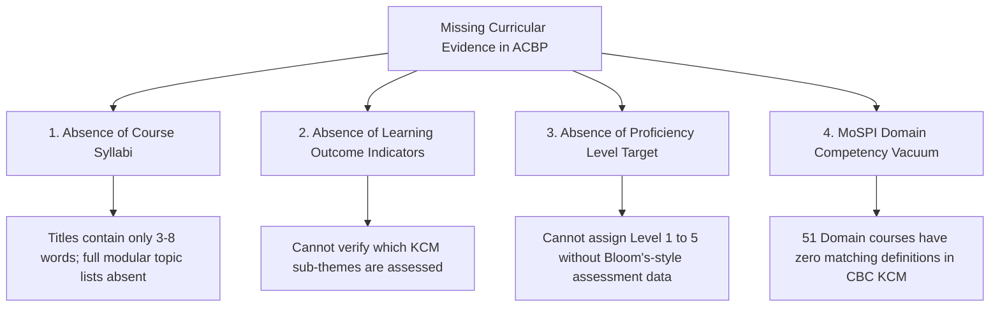

# Competency Mapping Review: Audit of Baseline Candidates & Methodological Case Studies

> **Document Status:** Quality Audit & Methodological Review  
> **Milestone:** SIH26101 — Stage 3.1: Design the Competency Mapping Framework  
> **Audit Target:** `data/processed/acbp_kcm_candidate_mappings.json` (Stage 2B.2 Interim Baseline)  
> **Source Documents Audited:**  
> - `data/processed/acbp_courses.json` (`SRC-MOSPI-ACBP-2026-27`)  
> - `data/processed/competencies_kcm.json` (`SRC-CBC-KCM-2024`)  
> **Author:** Antigravity AI & SIH26101 Engineering Team  

---

## 1. Audit Overview & Context

During Stage 2B.2, an initial exploratory script evaluated all **226 course allocations** in the MoSPI ACBP catalogue against the **34 competencies** of the Karmayogi Competency Model. 
- **220 courses** were marked `unresolved` with `candidate_kcm_competency_id = null`.
- **6 courses** were extracted as explicit candidate linkages based on title wording overlap.

In this document, we execute a rigorous, record-by-record forensic audit of those six candidate mappings to evaluate:
1. Cross-document existence and relational integrity.
2. Source reference and page-number accuracy.
3. Distinction between lexical token overlap and genuine curricular learning outcomes.
4. Methodological validity of heuristic confidence scores.
5. Specific missing evidence required before any candidate could be considered for institutional validation.

---

## 2. Six-Row Forensic Audit of Current Candidate Mappings

The table below catalogs the detailed forensic audit for each of the six baseline candidate mappings:

| Record ID & Cadre | Source Course Title & Metadata | Cited KCM Competency & Pages | Lexical Overlap vs. Curricular Evidence | Ambiguities, Over-Broad Scope, & Score Critique | Audit Recommendation & Action |
| :--- | :--- | :--- | :--- | :--- | :--- |
| **Row 1**<br>`ACBP-CRS-017`<br><br>*Cadre:* DDG / Joint Sec. Eqv. & Above | **Title:** `Leading with Collaboration: Sahakaryata _in Public_Service`<br>**Category:** `Behavioural`<br>**Duration:** `00:46:21`<br>**Creator:** `CBC`<br>**Page/Row:** Page 2, Row 17 | **ID:** `KCM-BEH-06`<br>**Name:** `Collaboration`<br>**Type:** `behavioural`<br>**KCM Pages:** `[49, 50]`<br>*Sub-themes:* Fostering Trust, Networking, Team Work, Conflict Management. | **Lexical:** The token *"Collaboration"* appears verbatim in the course title.<br><br>**Curricular Gap:** Course duration is 46 minutes, created by CBC. However, the ACBP provides zero syllabus text, modular breakdown, or assessment rubrics. It is unknown whether the course addresses all 4 sub-themes or focuses narrowly on inter-departmental protocols. | **Score Critique:** Assigned confidence of `0.85` in Stage 2B.2 is an uncalibrated heuristic decimal. Title overlap does not equal 85% probabilistic certainty of competency mastery.<br><br>**OCR Noise:** Title has OCR scan noise (`_in`, `Public_Service`). | **Recommendation:** **REVISE TO `exact_title_reference`**.<br><br>*Action:* Retain as candidate hypothesis. Strip numeric confidence score to `null`. Update rationale to explicitly state that learning outcomes across sub-themes (Trust, Conflict) remain unverified pending iGOT syllabus audit. |
| **Row 2**<br>`ACBP-CRS-036`<br><br>*Cadre:* Director / Joint Director | **Title:** `Leadership in Project Management`<br>**Category:** `Functional`<br>**Duration:** `00:36:26`<br>**Creator:** `DoPT`<br>**Page/Row:** Page 3, Row 13 | **ID:** `KCM-FUNC-05`<br>**Name:** `Project Management`<br>**Type:** `functional`<br>**KCM Pages:** `[74, 75]`<br>*Sub-themes:* Project Planning, Project Implementation, Project Evaluation, Project KPIs Monitoring. | **Lexical:** Substring match on *"Project Management"*.<br><br>**Curricular Gap:** The title is a compound phrase: *"Leadership in Project Management"*. Does the course teach technical project management (planning, PERT/CPM, KPIs on p. 75) or behavioural leadership of project teams? | **Ambiguity:** High risk of domain conflation between `KCM-FUNC-05` (Functional Project Management) and `KCM-BEH-10` (Strategic Leadership). A 36-minute DoPT lecture cannot cover comprehensive project execution methodologies.<br><br>**Score Critique:** Confidence `0.85` is unsubstantiated. | **Recommendation:** **REVISE TO `curated_candidate` (Flagged Ambiguous)**.<br><br>*Action:* Flag for dual-competency review (`KCM-FUNC-05` vs `KCM-BEH-10`). Strip numeric score. Note in `reviewer_notes` that course likely focuses on leadership style within project teams rather than functional project management tools. |
| **Row 3**<br>`ACBP-CRS-040`<br><br>*Cadre:* Director / Joint Director | **Title:** `Strategic Leadership: The Indic_ Way`<br>**Category:** `Behavioural`<br>**Duration:** `00:41:03`<br>**Creator:** `CBC`<br>**Page/Row:** Page 3, Row I7 (*OCR noise for 17*) | **ID:** `KCM-BEH-10`<br>**Name:** `Strategic Leadership`<br>**Type:** `behavioural`<br>**KCM Pages:** `[57, 58]`<br>*Sub-themes:* Visioning, Transforming for Future, Strategic Alignment, Systems Thinking. | **Lexical:** Verbatim match on *"Strategic Leadership"*.<br><br>**Curricular Gap:** The subtitle *"The Indic Way"* indicates an epistemological or philosophical orientation grounded in Indian administrative history. KCM's definition focuses on visioning, transforming, and systems thinking. Alignment is plausible but unverified at the sub-theme level. | **Score Critique:** Assigned confidence of `0.90` is arbitrarily higher than `0.85` for Row 1 with no methodological justification.<br><br>**Provenance Anomaly:** `source_row` in interim table is recorded as `"I7"` due to OCR digit misread (letter 'I' instead of '1'). | **Recommendation:** **REVISE TO `exact_title_reference`**.<br><br>*Action:* Retain candidate link. Set confidence to `null`. Note row index normalization requirement (`I7` -> `17`). Maintain status as `pending_review`. |
| **Row 4**<br>`ACBP-CRS-041`<br><br>*Cadre:* Director / Joint Director | **Title:** `Leading with Collaboration: Sahakaryata _in Public Service`<br>**Category:** `Behavioural`<br>**Duration:** `00:46:21`<br>**Creator:** `CBC`<br>**Page/Row:** Page 3, Row 18 | **ID:** `KCM-BEH-06`<br>**Name:** `Collaboration`<br>**Type:** `behavioural`<br>**KCM Pages:** `[49, 50]`<br>*Sub-themes:* Fostering Trust, Networking, Team Work, Conflict Management. | **Lexical:** Exact match on *"Collaboration"*. Identical course to Row 1 (`ACBP-CRS-017`) assigned to Director cadre.<br><br>**Curricular Gap:** Same syllabus gap as Row 1. The duration (`00:46:21`) and provider (`CBC`) are identical. | **Cadre Nuance:** Does a 46-minute video target Director-level collaborative governance or general civil service teamwork? Without learning-outcome indicators, depth cannot be determined.<br><br>**Score Critique:** Confidence `0.85` is arbitrary. | **Recommendation:** **REVISE TO `exact_title_reference`**.<br><br>*Action:* Maintain exact parity with Row 1. Strip numeric score to `null`. Record as distinct cadre deployment of the same course asset. |
| **Row 5**<br>`ACBP-CRS-060`<br><br>*Cadre:* Deputy Secretary / Under Secretary | **Title:** `Strategic Leadership: _The_Indic_ Way`<br>**Category:** `Behavioural`<br>**Duration:** `00:41:03`<br>**Creator:** `CBC`<br>**Page/Row:** Page 4, Row 15 | **ID:** `KCM-BEH-10`<br>**Name:** `Strategic Leadership`<br>**Type:** `behavioural`<br>**KCM Pages:** `[57, 58]`<br>*Sub-themes:* Visioning, Transforming for Future, Strategic Alignment, Systems Thinking. | **Lexical:** Exact match on *"Strategic Leadership"*. Course asset identical to Row 3 (`ACBP-CRS-040`), deployed to Deputy Secretary cadre.<br><br>**Curricular Gap:** Identical to Row 3. | **Cadre Mismatch Concern:** Strategic Leadership (KCM-BEH-10) is typically defined for senior civil servants (Joint Secretary and above). Deploying this course to Under Secretaries suggests either introductory orientation or broad institutional exposure.<br><br>**Score Critique:** Confidence `0.90` is arbitrary. | **Recommendation:** **REVISE TO `exact_title_reference`**.<br><br>*Action:* Retain candidate link. Set confidence to `null`. Document cadre deployment pattern across Ministry levels. |
| **Row 6**<br>`ACBP-CRS-061`<br><br>*Cadre:* Deputy Secretary / Under Secretary | **Title:** `Leading with Collaboration: Sahakaryata in Public_Service_`<br>**Category:** `Behavioural`<br>**Duration:** `00:46:21`<br>**Creator:** `CBC`<br>**Page/Row:** Page 4, Row 16 | **ID:** `KCM-BEH-06`<br>**Name:** `Collaboration`<br>**Type:** `behavioural`<br>**KCM Pages:** `[49, 50]`<br>*Sub-themes:* Fostering Trust, Networking, Team Work, Conflict Management. | **Lexical:** Exact match on *"Collaboration"*. Third cadre deployment of this course asset.<br><br>**Curricular Gap:** Identical to Rows 1 and 4. | **Score Critique:** Confidence `0.85` is arbitrary.<br><br>**OCR Specks:** Trailing underscore in OCR string (`Public_Service_`). | **Recommendation:** **REVISE TO `exact_title_reference`**.<br><br>*Action:* Retain candidate link with `null` confidence score. Mark for batch validation when CBC course syllabus is acquired. |

---

## 3. Systematic Itemization of Missing Evidence

Our audit of the 226 ACBP courses against the KCM baseline reveals that **available source documentation lacks four critical categories of evidence**, explaining why 220 courses remain legitimately unresolved:



1. **Absence of Modular Course Syllabi:** The ACBP source table (Annexure I) provides strictly five fields per course: Cadre, Course Name, Category, Duration, and Creator. It provides **no summary paragraph, no module syllabus, no lecture outline, and no list of covered topics**.
2. **Absence of Observable Learning Outcomes:** KCM competencies are defined by concrete behavioural indicators (e.g., *"Anticipates internal and external changes and formulates long-term goals"* for `Strategic Leadership`). A course title alone cannot prove whether an officer is trained or assessed on these specific actions.
3. **Absence of Proficiency / Mastery Target:** Neither CBC nor MoSPI assigns competency levels (Levels 1 to 5) to these courses. Without knowing whether a course is an introductory orientation (Level 1) or advanced executive strategy (Level 4/5), assigning a level would be pure fabrication.
4. **The MoSPI Domain Competency Vacuum:** Exactly **51 courses** in the ACBP catalogue represent specialized official statistical domains:
   - *Index Numbers*, *National Accounts*, *Sample Registration System (SRS)*, *Overview of Basic Statistics*, *Survey Methodology*, *PM Gatishakti*, *Bhashini*.
   The CBC KCM document defines **zero domain competencies**. Therefore, these 51 courses have **no valid target in the KCM model**. Attempting to force them into KCM functional competencies (e.g. mapping *Basic Statistics* to *Data Analytics*) violates source intent.

---

## 4. Ground-Truth Comparative Case Studies

To illustrate the practical application of this framework, we analyze two contrasting records from the ACBP catalogue: one **defensible candidate mapping** and one **strictly unresolved case**.

---

### Case Study 1: A Defensible Candidate Mapping (`ACBP-CRS-040`)

```text
Course Record ID:       ACBP-CRS-040
Cadre / Role:           Director / Joint Director
Course Title:           Strategic Leadership: The Indic Way
ACBP Category:          Behavioural
Course Duration:        00:41:03
Course Creator:         CBC (Capacity Building Commission)
Course Source:          SRC-MOSPI-ACBP-2026-27 (Page 3, Row I7)

Candidate Competency:   KCM-BEH-10 (Strategic Leadership)
Competency Type:        Behavioural
KCM Source:             SRC-CBC-KCM-2024 (Pages 57–58)
Sub-Themes:             Visioning, Transforming for Future, Strategic Alignment, Systems Thinking
```

#### Why This Mapping is Defensible as a Candidate
1. **Curricular Alignment:** The primary clause of the course title (*"Strategic Leadership"*) is character-identical to the canonical KCM competency title.
2. **Institutional Provenance Alignment:** The course creator is the **Capacity Building Commission (CBC)**—the exact same institutional author that published the Karmayogi Competency Model. It is administratively probable that CBC commissioned this course specifically to support `KCM-BEH-10`.
3. **Cadre Coherence:** The target cadre (*Director / Joint Director*) represents senior leadership responsible for strategic alignment and organizational direction, matching the cognitive scope of `KCM-BEH-10`.
4. **Category Parity:** Both the ACBP document and the KCM document categorize the subject as **Behavioural**.

#### Why It Remains a Candidate (Pending Review) Rather than Validated
- The course has a 41-minute duration and an *"Indic Way"* cultural perspective. While valuable, we have not audited whether it assesses the four KCM sub-themes (*Visioning, Transforming for Future, Strategic Alignment, Systems Thinking*).
- **Correct Status:** `mapping_type = "exact_title_reference"`, `validation_status = "pending_review"`, `confidence_score = null`.

---

### Case Study 2: An Unresolved Case Where Mapping Would Be Error (`ACBP-CRS-030`)

```text
Course Record ID:       ACBP-CRS-030
Cadre / Role:           Director / Joint Director
Course Title:           PM Gatishakti
ACBP Category:          Domain
Course Duration:        00:30:00 (approx. 30m standard module)
Course Creator:         BISAG-N / Ministry of Commerce & Industry
Course Source:          SRC-MOSPI-ACBP-2026-27 (Page 3, Row 1)

Candidate Competency:   NONE (Strictly Unresolved)
Candidate KCM ID:       null
```

#### The Heuristic Drift Hazard (Why an Aggressive Algorithm Would Err)
An unconstrained semantic or keyword-matching model might note that *PM Gatishakti* involves national infrastructure master plans, project coordination, and geographic information systems. The model might propose mapping it to:
- `KCM-FUNC-05` (*Project Management*), because Gatishakti coordinates infrastructure projects; OR
- `KCM-FUNC-07` (*Data Analytics & Visualization*), because Gatishakti uses GIS maps; OR
- `KCM-FUNC-04` (*Government Program Formulation*), because Gatishakti is a flagship national program.

#### Why Forcing Such a Mapping is Erroneous & Unauditable
1. **Category Violation:** In the source ACBP document, MoSPI explicitly categorized `PM Gatishakti` as **`Domain`**, NOT `Functional` or `Behavioural`. Forcing it into a KCM Functional competency overrides the official ministry categorization.
2. **Subject Matter Distortion:** *PM Gatishakti National Master Plan* is a multi-modal connectivity initiative, not a general administrative course on project management principles or CPM/PERT charts. Mapping it to `KCM-FUNC-05` misrepresents the course content.
3. **Absence of MoSPI Domain Taxonomy:** This course is part of the MoSPI Domain requirement for officers to understand spatial data and inter-ministerial data integration. KCM does not contain a Domain competency for Spatial Data or Infrastructure Statistics.
4. **Correct Methodological Outcome:**  
   - `mapping_type = "unresolved"`  
   - `candidate_kcm_competency_id = null`  
   - `validation_status = "unresolved"`  
   - `evidence_or_rationale = "Course is classified by MoSPI as Domain (PM Gatishakti spatial infrastructure platform). The CBC KCM model contains zero Domain competencies. Mapping to generic KCM Functional competencies would introduce false classification. Retained as unresolved pending MoSPI/NSSTA Domain Competency Dictionary integration."`

---

## 5. Summary Audit Matrix & Recommendations

| Metric | Interim Baseline Value (Stage 2B.2) | Audited Value (Stage 3.1) | Corrective Action Required |
| :--- | :---: | :---: | :--- |
| **Total Evaluated Courses** | 226 | 226 | Preserved intact. |
| **Candidate Mappings** | 6 | 6 | Reclassify all 6 from arbitrary floats (`0.85`, `0.90`) to `exact_title_reference` with `confidence_score = null`. |
| **Unresolved Courses** | 220 | 220 | Retained as audited unresolved records with explicit rationale (Domain gaps vs missing syllabi). |
| **Fabricated Competency Levels** | 0 | 0 | Invariant strictly maintained (`level = null`). |
| **Domain Courses Forcibly Mapped** | 0 | 0 | Invariant strictly maintained (all 51 Domain courses remain unresolved). |
| **Validation Promotion** | 0 | 0 | Zero records promoted to `validated`; all remain `pending_review` or `unresolved`. |
