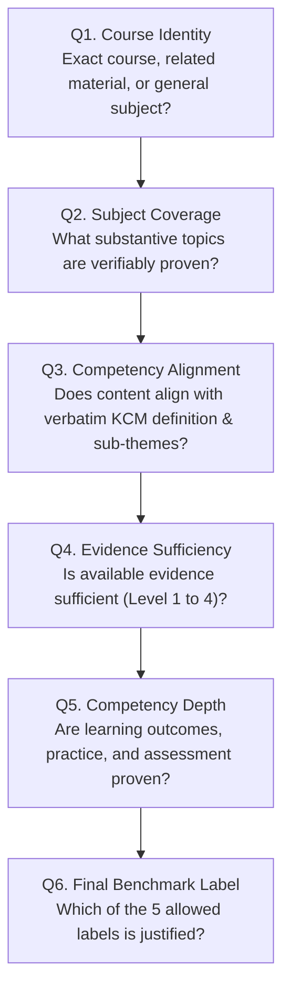
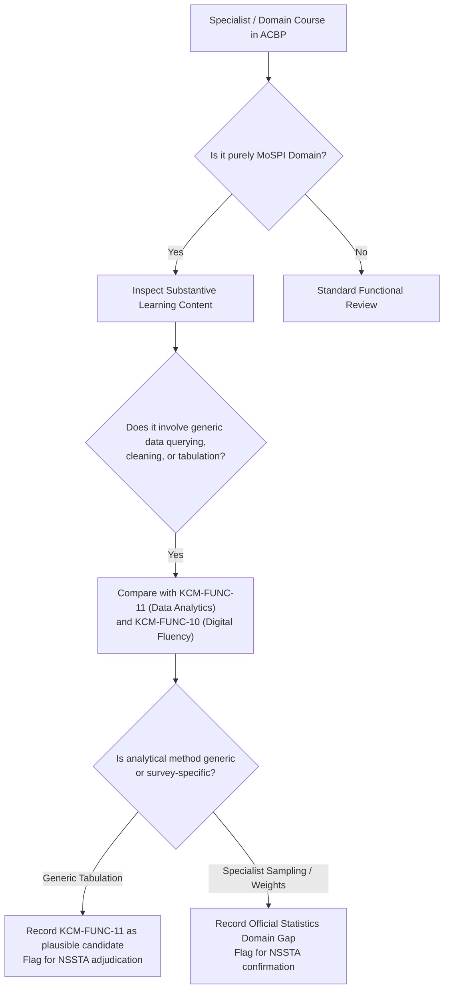
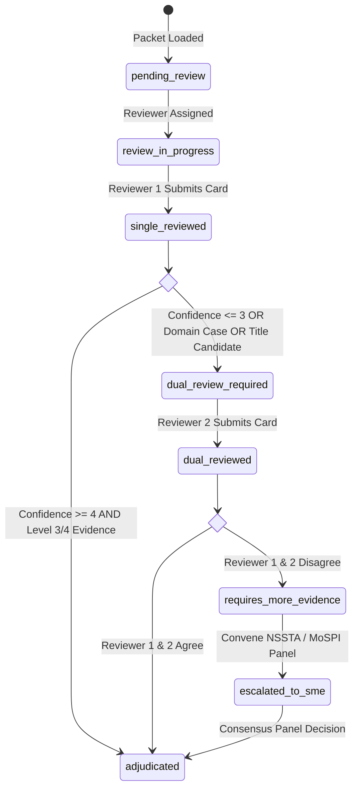

# MoSPI ACBP to KCM Competency Mapping: Human Adjudication Guide

> [!IMPORTANT]
> **Document Status**: OPERATIONAL ADJUDICATION MANUAL (Stage 3.4.2)  
> **Target Frameworks**: Mission Karmayogi (NPCSCB / CBC) & Ministry of Statistics and Programme Implementation (MoSPI / NSSTA)  
> **Associated Machine-Readable Artifacts**:  
> - Adjudication Packet (JSON): [`data/interim/mapping_adjudication_packet.json`](file:///d:/Projects/SIH26101/SIH26101-Skill-Intelligence/data/interim/mapping_adjudication_packet.json)  
> - Adjudication Packet (CSV): [`data/interim/mapping_adjudication_packet.csv`](file:///d:/Projects/SIH26101/SIH26101-Skill-Intelligence/data/interim/mapping_adjudication_packet.csv)  
> - Packet Builder Script: [`scripts/build_adjudication_packet.py`](file:///d:/Projects/SIH26101/SIH26101-Skill-Intelligence/scripts/build_adjudication_packet.py)  
> - Automated Test Suite: [`tests/test_adjudication_packet.py`](file:///d:/Projects/SIH26101/SIH26101-Skill-Intelligence/tests/test_adjudication_packet.py)

---

## 1. Purpose & Guiding Principles

This guide establishes the standardized adjudication protocol for subject-matter experts (SMEs), curriculum evaluators, and training officers evaluating alignments between the **MoSPI Annual Capacity Building Plan (ACBP 2026–27)** and the **Karmayogi Competency Model (KCM 2024)**.

### Core Philosophy
1. **Evidence Quality Over Mapping Coverage**: In civil service capacity building, an erroneous or unevidenced competency mapping distorts promotional training, misallocates public capacity budgets, and obscures systemic capability deficits. An unresolved case is vastly superior to a forced, unevidenced mapping.
2. **Four Critical Distinctions (The Conflation Safeguard)**:
   Reviewers must never conflate:
   - *A subject being relevant to a competency* (topical overlap)
   - *A course explicitly teaching that competency* (instructional focus)
   - *A course developing competency to a particular proficiency level* (pedagogical depth)
   - *A learner actually possessing that competency* (individual assessment outcome)
3. **Zero Automated Fabrication**: Automated scripts and heuristic candidate generators may suggest candidates for review, but only qualified human evaluators can assign benchmark ground-truth labels.

---

## 2. The 6-Question Adjudication Decision Process

Every reviewer must sequentially evaluate and record findings for six distinct questions before assigning a benchmark label:



### Question 1: Course Identity
*Is the evidence demonstrably about the exact ACBP course, a related course, or only the general subject?*
- **Exact Course**: Evidence consists of the verified syllabus, session plan, or module breakdown of the exact iGOT or classroom course title and duration.
- **Related Course Material**: Evidence consists of authentic curricula, training manuals, or publications from the listed provider (e.g. ISTM, NSSTA, AJ-NIFM, MDNIY) covering the topic, but not the specific online micro-module.
- **General Subject Matter**: Evidence covers broad statutory rules, government acts, or policy circulars without direct curricular connection.
- **Access-Restricted / Unverified**: Course exists behind authenticated civil service portals (e.g. Parichay SSO on iGOT) with unverified granular session plans.

### Question 2: Subject Coverage
*What content is actually supported by the available evidence?*
- Reviewers must extract and document the verified topics. If a document only lists chapter titles without session outlines, reviewers must record that topical breadth is verified but instructional granularity is unknown.

### Question 3: Competency Alignment
*Does that content align with the precise KCM competency definition and, where applicable, a specific sub-theme or behavioural indicator?*
- Reviewers must compare verified course content against the official KCM definition and sub-theme descriptions in [`data/processed/competencies_kcm.json`](file:///d:/Projects/SIH26101/SIH26101-Skill-Intelligence/data/processed/competencies_kcm.json).
- Direct quotations or verbatim citations must be used. Reviewers must never invent competency IDs absent from KCM (e.g. do not invent `KCM-DOM-01`).

### Question 4: Evidence Sufficiency
*Is there enough evidence to support the proposed mapping?*
Reviewers must classify evidence into the four official evidentiary levels:
- **Level 1 (Course Title Only)**: Heuristic candidate only. Strictly insufficient for ground truth.
- **Level 2 (High-Level Summary / Training Calendar)**: Plausible for triage, insufficient for supported mapping.
- **Level 3 (Granular Session Plan / Module Outline)**: Minimum requirement for a `supported_mapping` label.
- **Level 4 (Observable Behavioral Learning Outcomes & Assessment)**: Gold standard ground truth with multi-indicator alignment.

### Question 5: Competency Depth & Pedagogical Limitations
*Is there evidence about learning objectives, practice, assessment, or mastery?*
- Reviewers must inspect course duration and modality. A 15-minute or 45-minute video lecture cannot develop advanced functional proficiency (e.g., GFR public procurement or quasi-judicial disciplinary inquiry).
- When formative quizzes, simulation exercises, or practical case studies are absent, reviewers must explicitly record: *"Introductory conceptual awareness only; cannot certify competency mastery."*

### Question 6: Final Benchmark Label
*Which existing benchmark label is justified by the evidence?*
Reviewers must select strictly from the 5 approved taxonomy labels:

| Benchmark Label | Strict Definition | Permitted Target KCM ID | Required Evidence Tier |
| :--- | :--- | :--- | :--- |
| **`supported_mapping`** | Verifiable curricular evidence proves alignment with specific KCM competency and behavioral sub-theme. | Mandatory (`KCM-BEH-*` or `KCM-FUNC-*`) | Level 3 or Level 4 |
| **`plausible_insufficient_evidence`** | Title or high-level outline plausibly aligns, but granular syllabus is unmirrored, restricted, or too brief to prove mastery. | Mandatory candidate ID | Level 1 or Level 2 |
| **`incorrect_mapping`** | Proposed mapping is factually erroneous, misaligned in scope, or contradicts verified course content. | Null or Rejected ID | Contradictory evidence citation |
| **`unresolved_insufficient_source`** | Course covers administrative/behavioral topics, but zero verified course documentation exists locally to evaluate it. | Null | Formal notation of missing syllabus |
| **`no_applicable_kcm_competency`** | Course covers specialist official statistics, survey methodology, or domain topics unrepresented in KCM 2024. | Must be `null` | Primary source proof of domain gap |

---

## 3. Protocol for Domain Competencies (Official Statistics Gap)

Courses in Strata D (e.g., HCES, ASI, Official Statistics in India) require specialized review safeguards:



### Strict Rules for Domain Course Adjudication:
1. **Never Auto-Infer Domain Gap from ACBP Category**:
   - Courses like `ACBP-CRS-001` (*Introduction to Big Data in Governance*) and `ACBP-CRS-072` (*Cyber Hygiene*) were categorized as "Domain" in ACBP, but are created by NeGD/MeitY for all civil servants. They align with `KCM-FUNC-10` (*Digital Fluency*) and `KCM-FUNC-11` (*Data Analytics*).
   - Reviewers must evaluate actual learning content rather than trusting the ACBP category header.
2. **Microdata vs Survey Methodology Distinction**:
   - For `ACBP-CRS-067` (*HCES*) and `ACBP-CRS-069` (*ASI*), microdata handling (reading fixed-width ASCII / CSV, calculating aggregates) shares conceptual overlap with generic `KCM-FUNC-11` (*Data Analytics*).
   - However, survey weighting, multiplier calculation, sampling error estimation, and consumer expenditure basket concepts represent specialist official statistics domain knowledge.
   - **Mandatory Procedure**: Retain `unresolved_insufficient_source` with a triage note of `potential_domain_gap_requires_adjudication`. Do not assign `no_applicable_kcm_competency` without NSSTA faculty confirmation.
3. **No Fabricated Domain Competency IDs**:
   - Evaluators must never assign invented codes like `KCM-DOM-01` or `KCM-STAT-01`. If a domain gap is confirmed, the target KCM ID must be recorded as `null` with label `no_applicable_kcm_competency`.

---

## 4. Confidence Rating Scale (1 to 5)

Every adjudication record must include an explicit confidence score on an anchored 1–5 scale:

| Score | Level | Operational Definition & Criteria |
| :---: | :--- | :--- |
| **1** | **Very Low** | Speculative or title-only evidence. No syllabus, module outline, or verified session plan is available. |
| **2** | **Low** | Related subject material identified from apex institutions, but exact iGOT course module outline is unverified. |
| **3** | **Moderate** | Apex institutional curriculum verified (e.g. ISTM classroom syllabus), but course duration, delivery modality, or audience differs from the online micro-course. |
| **4** | **High** | Granular course session outline verified with direct alignment to specific KCM sub-theme indicators, but lacking assessment data. |
| **5** | **Very High** | Complete syllabus with observable behavioral learning outcomes, practice exercises, and formative/summative assessment criteria verified. |

---

## 5. Reviewer Workflow & Consensus Resolution



### Workflow Rules:
1. **Independent Review Prior to Consensus**:
   - Reviewer 1 and Reviewer 2 must evaluate cases independently without viewing each other's notes or scores.
2. **Mandatory Dual Review Criteria**:
   - Any case with confidence rating $\le 3$.
   - All 6 title-reference candidate cases (Strata A).
   - All 5 domain-gap and statistical courses (Strata D).
   - Any case where a candidate is proposed for rejection (`incorrect_mapping`).
3. **Disagreement Resolution**:
   - If Reviewers 1 and 2 assign differing benchmark labels, the case enters `requires_more_evidence`.
   - The case is referred to an NSSTA / MoSPI Subject Matter Expert panel for final binding consensus.

---

## 6. Structure of the Adjudication Packet

The adjudication data is distributed in two machine-readable formats:
- JSON: [`data/interim/mapping_adjudication_packet.json`](file:///d:/Projects/SIH26101/SIH26101-Skill-Intelligence/data/interim/mapping_adjudication_packet.json)
- CSV: [`data/interim/mapping_adjudication_packet.csv`](file:///d:/Projects/SIH26101/SIH26101-Skill-Intelligence/data/interim/mapping_adjudication_packet.csv)

### Blank Human Review Fields
To safeguard evaluation integrity, the following fields are strictly initialized to `null` (or empty string in CSV) and must remain blank until a human evaluator records a decision:

```json
{
  "adjudication_status": "pending_review",
  "adjudicated_label": null,
  "adjudicated_target_kcm_id": null,
  "adjudicated_target_kcm_name": null,
  "adjudicated_subtheme": null,
  "evidence_sufficiency_verdict": null,
  "depth_assessment": null,
  "reviewer_id": null,
  "reviewer_role": null,
  "adjudication_date": null,
  "reviewer_rationale": null,
  "confidence_rating": null,
  "second_reviewer_required": null,
  "consensus_status": null
}
```

Any automated tool, script, or model that populates these fields without human authorization violates repository integrity constraints and will fail regression tests.
