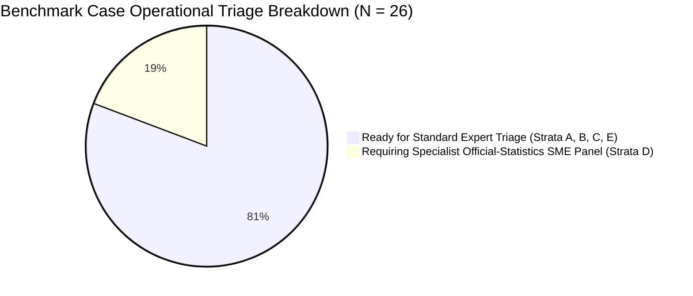

# MoSPI ACBP to KCM Competency Mapping: Adjudication Readiness Report (Stage 3.4.2)

> [!IMPORTANT]
> **Readiness Status**: **READY FOR EXPERT TRIAGE — PENDING EXTERNAL EVIDENCE REQUISITION**  
> **Key Finding**: The 26-case pilot benchmark is fully packaged, structured, and auditable for expert human review. **No benchmark case has been marked as human-validated or assigned an automated ground truth label.**  
> **Primary Deliverables**:  
> - Machine-Readable Adjudication Packet (JSON): [`data/interim/mapping_adjudication_packet.json`](file:///d:/Projects/SIH26101/SIH26101-Skill-Intelligence/data/interim/mapping_adjudication_packet.json)  
> - Tabular Adjudication Packet (CSV): [`data/interim/mapping_adjudication_packet.csv`](file:///d:/Projects/SIH26101/SIH26101-Skill-Intelligence/data/interim/mapping_adjudication_packet.csv)  
> - Deterministic Packet Builder Script: [`scripts/build_adjudication_packet.py`](file:///d:/Projects/SIH26101/SIH26101-Skill-Intelligence/scripts/build_adjudication_packet.py)  
> - Automated Test Suite: [`tests/test_adjudication_packet.py`](file:///d:/Projects/SIH26101/SIH26101-Skill-Intelligence/tests/test_adjudication_packet.py)  
> - Reviewer Adjudication Guide: [`docs/mapping_adjudication_guide.md`](file:///d:/Projects/SIH26101/SIH26101-Skill-Intelligence/docs/mapping_adjudication_guide.md)

---

## 1. Executive Summary & Readiness Verdict

Stage 3.4.2 prepares the comprehensive human-adjudication package for the 26-case MoSPI ACBP to KCM competency-mapping benchmark. 

The primary goal of this stage is to make human expert review **transparent, reproducible, evidence-based, and operationally safe**. It enforces complete segregation between heuristic triage recommendations and binding human decisions.

```
======================================================================
STAGE 3.4.2 ADJUDICATION READINESS VERDICT: READY FOR EXPERT TRIAGE
======================================================================
Total Benchmark Cases: 26
  - Structured Adjudication Cards Built: 26 / 26 (100.0%)
  - Blank Human Review Fields Preserved: 26 / 26 (100.0%)
  - Human Review Status: 'pending_review' (26 / 26)
  - Evaluated Against 6-Question Framework: 26 / 26 (100.0%)
  - Exact-Course Verified Locally: 0 / 26 (0.0%)
  - Blocked for Ground Truth Certification Pending Syllabi: 26 / 26 (100.0%)
======================================================================
```

### Critical Declarations:
1. **Zero Human Decisions Fabricated**: All reviewer fields (`adjudicated_label`, `reviewer_id`, `adjudication_date`, `reviewer_rationale`, `confidence_rating`) remain strictly `null` across all 26 cases.
2. **Production Registry Untouched**: The 226-record production mapping registry ([`data/processed/acbp_kcm_mappings.json`](file:///d:/Projects/SIH26101/SIH26101-Skill-Intelligence/data/processed/acbp_kcm_mappings.json)) remains completely unmodified. Zero candidates have been promoted to `validated`.
3. **No Private Portal Access Claimed**: The platform honestly documents that 9 courses are access-restricted behind civil service Parichay single sign-on (SSO) on iGOT Karmayogi.

---

## 2. Benchmark Case Categorization & Triage Readiness

To organize expert panel time efficiently, all 26 benchmark cases are categorized into three operational readiness tiers:



### Category 1: Ready for Expert Human Triage (26 / 26 Cases)
- **Status**: Every case possesses a complete machine-readable adjudication card containing:
  - Exact ACBP course title, cadre, duration, and provider.
  - Verbatim excerpt from official institutional documentation.
  - Analysis under the 6-question adjudication process.
  - Candidate KCM definition and sub-theme behavioral indicators (where applicable).
  - Counter-evidence, known limitations, and alternative competency candidates.
  - Targeted questions requiring SME judgment.
- **Action**: Evaluators can immediately commence preliminary scoring, confidence rating, and identification of required evidence.

### Category 2: Blocked for Final Ground-Truth Certification (26 / 26 Cases)
- **Status**: While all 26 cases have authentic institutional or portal evidence, **zero cases** possess a downloaded, lesson-by-lesson syllabus for the exact micro-course locally.
  - 12 cases rely on related apex institutional curricula (ISTM, NSSTA, AJ-NIFM, MDNIY).
  - 9 cases are hosted on iGOT Karmayogi behind Parichay SSO.
  - 5 cases rely on high-level institutional frameworks or training calendar rows.
- **Action**: Final `supported_mapping` ground-truth certification must be withheld until formal data requisitions provide granular lesson plans.

### Category 3: Requiring Specialist Official-Statistics Domain Judgment (5 Cases)
Cases in Strata D require review by senior official statisticians and NSSTA faculty to resolve the boundary between generic central civil service competencies and specialist official statistical knowledge:

| Case ID | Course Record ID | Cadre | Exact Course Title | Current ACBP Category | Target Evaluation Issue |
| :--- | :--- | :--- | :--- | :--- | :--- |
| **BM-CASE-020** | `ACBP-CRS-001` | DDG / JS+ | Introduction to Big Data in Governance | Domain | Reconcile ACBP "Domain" category with provider NeGD (MeitY); evaluate alignment with `KCM-FUNC-10` (*Digital Fluency*) or `KCM-FUNC-11` (*Data Analytics*). |
| **BM-CASE-021** | `ACBP-CRS-046` | Director / JD | Official Statistics in India | Domain | Confirm whether national statistical system governance represents an unrepresented KCM Domain gap. |
| **BM-CASE-022** | `ACBP-CRS-067` | DS / US | Handling Unit Level Data of Household Consumption Expenditure Survey (HCES) | Domain | Evaluate whether microdata manipulation overlaps with `KCM-FUNC-11` (*Data Analytics*) vs specialist survey sampling weights constituting a pure Domain gap. |
| **BM-CASE-023** | `ACBP-CRS-069` | DS / US | Handling Unit Level Data of Annual Survey of Industries (ASI) | Domain | Evaluate economic data tabulation against `KCM-FUNC-11` (*Data Analytics*) vs enterprise sampling framework representing a Domain gap. |
| **BM-CASE-024** | `ACBP-CRS-072` | DS / US | Cyber Hygiene | Domain | Reconcile ACBP "Domain" classification with core civil service digital security behavior defined under `KCM-FUNC-10` (*Digital Fluency*). |

---

## 3. Case-by-Case Triage Guidance & Evidence Breakdown

### Strata A: Title-Reference Candidates (n = 6)
*Existing candidate mappings in the production registry requiring verification against instructional reality.*

| Case ID | Course Name | Cadre | Duration | Provider | Current Evidence Status | Proposed KCM ID | Triage Guidance Label | Key SME Question |
| :--- | :--- | :--- | :--- | :--- | :--- | :--- | :--- | :--- |
| **BM-CASE-001** | Leading with Collaboration | DDG / JS+ | 01.00.44 | CBC | `access_restricted` | `KCM-BEH-06` | `plausible_insufficient_evidence` | Does a 1-hour module develop observable behavioral collaboration for apex officers? |
| **BM-CASE-002** | Leadership in Project Management | Director / JD | 00.17.58 | ATI Mysuru | `possible_match_needs_verification` | `KCM-FUNC-05` | `plausible_insufficient_evidence` | Can an 18-minute micro-module impart technical project management competency? |
| **BM-CASE-003** | Strategic Leadership: The Indic Way | Director / JD | 01.09.28 | CBC | `possible_match_needs_verification` | `KCM-BEH-10` | `plausible_insufficient_evidence` | Does Indic statecraft satisfy modern bureaucratic metrics of strategic leadership? |
| **BM-CASE-004** | Leading with Collaboration | Director / JD | 01.00.44 | CBC | `access_restricted` | `KCM-BEH-06` | `plausible_insufficient_evidence` | Does Director-level delivery differ from apex delivery? |
| **BM-CASE-005** | Strategic Leadership: The Indic Way | DS / US | 01.09.28 | CBC | `possible_match_needs_verification` | `KCM-BEH-10` | `plausible_insufficient_evidence` | Is Strategic Leadership appropriate for middle management operational roles? |
| **BM-CASE-006** | Leading with Collaboration | DS / US | 01.00.44 | CBC | `access_restricted` | `KCM-BEH-06` | `plausible_insufficient_evidence` | Should identical digital assets across cadres receive differentiated proficiency ratings? |

---

### Strata B: Behavioural Unresolved (n = 6)
*ACBP Behavioural courses currently unmapped in the production registry.*

| Case ID | Course Name | Cadre | Duration | Provider | Current Evidence Status | Candidate KCM Options | Triage Guidance Label | Key SME Question |
| :--- | :--- | :--- | :--- | :--- | :--- | :--- | :--- | :--- |
| **BM-CASE-007** | Ayush for Wellness | DDG / JS+ | 00.45.00 | MDNIY | `official_related_material` | `KCM-BEH-01` vs Gap | `unresolved_insufficient_source` | Should wellness be classified outside civil service KCM scope? |
| **BM-CASE-008** | Emotional Intelligence for Administrators | Director / JD | 00.45.12 | LBSNAA | `access_restricted` | `KCM-BEH-01` / `02` | `unresolved_insufficient_source` | KCM 2024 omits Emotional Intelligence; which proxy sub-theme applies? |
| **BM-CASE-009** | Stress Management | Director / JD | 00.30.00 | MDNIY | `official_related_material` | `KCM-BEH-01` / `02` | `unresolved_insufficient_source` | Does stress management qualify as civil service Personal Effectiveness? |
| **BM-CASE-010** | Conflict Resolution | Director / JD | 00.45.00 | ISTM | `official_related_material` | `KCM-BEH-06` / `11` / `12` | `unresolved_insufficient_source` | Does Conflict Resolution map to Collaboration or Collaborative Leadership? |
| **BM-CASE-011** | Time Management | SSO / SO | 00.30.00 | ISTM | `official_related_material` | `KCM-BEH-02` / `08` | `unresolved_insufficient_source` | Does 30 minutes justify mapping to Personal Effectiveness or Operational Excellence? |
| **BM-CASE-012** | Interpersonal Skills | JSO / ASO | 00.45.00 | ISTM | `official_related_material` | `KCM-BEH-04` / `06` | `unresolved_insufficient_source` | For junior officers, should Interpersonal Skills map to Communication or Collaboration? |

---

### Strata C: Functional Unresolved (n = 7)
*ACBP Functional courses with strong topical matches to core central civil service competencies.*

| Case ID | Course Name | Cadre | Duration | Provider | Current Evidence Status | Primary Target KCM ID | Triage Guidance Label | Key SME Question |
| :--- | :--- | :--- | :--- | :--- | :--- | :--- | :--- | :--- |
| **BM-CASE-013** | Disciplinary Proceedings | DDG / JS+ | 01.15.00 | ISTM | `official_related_material` | `KCM-FUNC-17` | `plausible_insufficient_evidence` | Is 75 minutes sufficient to certify quasi-judicial inquiry competence? |
| **BM-CASE-014** | Formulation of Evidence Based Public Policy | DDG / JS+ | 00.45.00 | DoPT / LBSNAA | `possible_match_needs_verification` | `KCM-FUNC-02` | `plausible_insufficient_evidence` | Can a 45-minute overview develop policy formulation and cabinet note synthesis? |
| **BM-CASE-015** | Preparation of Budget | DDG / JS+ | 01.00.00 | AJ-NIFM | `official_related_material` | `KCM-FUNC-09` | `plausible_insufficient_evidence` | Does the course develop budget estimation under GFR/DFPR? |
| **BM-CASE-016** | Procedure for Handling of Parliamentary Matters | DDG / JS+ | 00.45.00 | ISTM | `official_related_material` | `KCM-FUNC-14` | `plausible_insufficient_evidence` | Does the session cover assurances, questions, and legislative drafting? |
| **BM-CASE-017** | Procurement of Goods, Services & Works | DS / US | 01.30.00 | AJ-NIFM | `official_related_material` | `KCM-FUNC-06` / `07` | `plausible_insufficient_evidence` | Is primary emphasis on GFR procurement rules or GeM portal operations? |
| **BM-CASE-018** | Reservation in Service | DS / US | 01.00.00 | ISTM | `official_related_material` | `KCM-FUNC-12` | `plausible_insufficient_evidence` | Does course develop post-based roster audit competence? |
| **BM-CASE-019** | Generative AI for Good Governance | DS / US | 00.30.00 | NeGD | `possible_match_needs_verification` | `KCM-FUNC-10` | `plausible_insufficient_evidence` | Is GenAI awareness a sub-theme of Digital Fluency or data science? |

---

### Strata D: Domain Statistical Gap (n = 5)
*Specialist statistical and e-governance courses requiring domain gap resolution.*

| Case ID | Course Name | Cadre | Duration | Provider | Current Evidence Status | Target Evaluation Options | Triage Guidance Label | Key SME Question |
| :--- | :--- | :--- | :--- | :--- | :--- | :--- | :--- | :--- |
| **BM-CASE-020** | Introduction to Big Data in Governance | DDG / JS+ | 00.46.21 | NeGD | `possible_match_needs_verification` | `KCM-FUNC-10` / `11` | `plausible_insufficient_evidence` | Why was generic Big Data classified as Domain in ACBP? |
| **BM-CASE-021** | Official Statistics in India | Director / JD | 01.30.00 | NSSTA | `official_related_material` | Domain Gap | `unresolved_insufficient_source` | Does statistical system governance confirm a KCM Domain gap? |
| **BM-CASE-022** | Handling Unit Level Data of HCES | DS / US | 02.00.00 | NSSTA | `official_related_material` | `KCM-FUNC-11` vs Gap | `unresolved_insufficient_source` | Map HCES to Data Analytics (`KCM-FUNC-11`) or Domain gap? |
| **BM-CASE-023** | Handling Unit Level Data of ASI | DS / US | 02.00.00 | NSSTA | `official_related_material` | `KCM-FUNC-11` vs Gap | `unresolved_insufficient_source` | Map ASI enterprise analysis to Data Analytics or Domain gap? |
| **BM-CASE-024** | Cyber Hygiene | DS / US | 00.30.00 | CERT-In | `possible_match_needs_verification` | `KCM-FUNC-10` | `plausible_insufficient_evidence` | Reconcile ACBP "Domain" classification with core civil service Digital Fluency. |

---

### Strata E: Cross-Cadre Contrast (n = 2)
*Contrasting supervisory vs clerical delivery of the identical course title.*

| Case ID | Course Name | Cadre | Duration | Provider | Current Evidence Status | Target KCM ID | Triage Guidance Label | Key SME Question |
| :--- | :--- | :--- | :--- | :--- | :--- | :--- | :--- | :--- |
| **BM-CASE-025** | Noting and Drafting | SSO / SO | 01.30.00 | ISTM | `official_related_material` | `KCM-FUNC-13` | `plausible_insufficient_evidence` | Does syllabus assess intermediate/advanced noting for Section Officers? |
| **BM-CASE-026** | Noting and Drafting | UDC / LDC / MTS | 01.00.00 | ISTM | `official_related_material` | `KCM-FUNC-13` | `plausible_insufficient_evidence` | Does 1-hour session target foundational operational proficiency (Level 1)? |

---

## 4. Formal Data Requisition Roadmap

To enable final human adjudication and move from preliminary triage to ground-truth certification, three formal data requisitions are required:

1. **Requisition 1: Capacity Building Commission (CBC) & iGOT Portal Team**:
   - Request: Lesson-level session outlines, video transcripts, and formative assessment rubrics for the 9 access-restricted courses (`BM-CASE-001`, `004`, `006`, `008`, `009`, `010`, `011`, `012`, `019`).
2. **Requisition 2: National Statistical Systems Training Academy (NSSTA)**:
   - Request: Official module outlines for HCES (`BM-CASE-022`), ASI (`BM-CASE-023`), and Official Statistics in India (`BM-CASE-021`), with specific faculty guidance on whether microdata extraction maps to `KCM-FUNC-11` (*Data Analytics*).
3. **Requisition 3: Institute of Secretariat Training and Management (ISTM)**:
   - Request: Differentiated syllabus documents for Noting & Drafting across Supervisory (`BM-CASE-025`) and Clerical (`BM-CASE-026`) cadres.

---

## 5. Conclusion & Operational Status

The Human Adjudication Pack for Stage 3.4.2 is complete, verified, and ready for deployment. The evaluation platform guarantees that no automated label will overwrite human review, ensuring total fidelity to Mission Karmayogi's competency standards.
