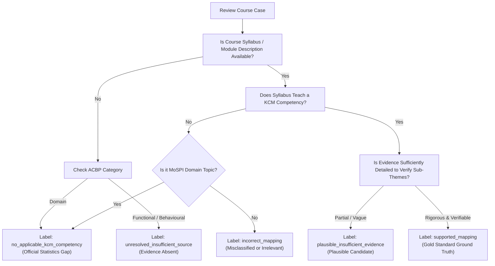

# MoSPI ACBP to KCM Competency Mapping Benchmark: Annotation & Evaluation Protocol

> [!IMPORTANT]
> **Status**: PROPOSED PROJECT PROTOCOL REQUIRING STAKEHOLDER APPROVAL  
> **Target Frameworks**: Mission Karmayogi (NPCSCB / CBC) & Ministry of Statistics and Programme Implementation (MoSPI / NSSTA)  
> **Baseline Data**: Stage 3.2.2 Hardened Competency Mapping Registry  
> **Document Version**: 1.0.0 (Stage 3.3)  
> **Author**: SIH26101 Core Engineering & Evaluation Team  
> **Review Status**: Pending formal review by MoSPI Training Division / NSSTA Subject Matter Experts.

---

## 1. Purpose and Guiding Philosophy

The purpose of this protocol is to define rigorous, auditable, and scientifically defensible standards for evaluating competency mappings between the **MoSPI Annual Capacity Building Plan (ACBP 2026–27)** course catalogue and the **Karmayogi Competency Model (KCM 2024)**.

### Core Evaluation Principle
> **"Evidence Quality Over Mapping Coverage."**  
> Civil service capacity building under Mission Karmayogi impacts promotion paths, continuous professional development, and statistical service delivery. An unevidenced or hallucinated competency mapping degrades trust, misdirects training budgets, and obscures systemic skill deficits. Therefore, an unresolved mapping is vastly superior to a forced, unevidenced mapping.

---

## 2. Standards of Sufficient Evidence

To validate an alignment between an ACBP course and a KCM competency, reviewers must evaluate evidence against a strict hierarchy:

```
[Level 1: Course Title Overlap] (Heuristic / Candidate Only — INSUFFICIENT for Ground Truth)
          │
          ▼
[Level 2: Learning Objectives & Module Summary] (Minimum requirement for Plausible)
          │
          ▼
[Level 3: Full Syllabus & Behavioral Learning Outcomes] (Required for Supported Ground Truth)
          │
          ▼
[Level 4: Sub-Theme Indicator Alignment] (Gold Standard: Multi-indicator curricular match)
```

### 2.1 What Constitutes Sufficient Evidence?
Evidence is deemed **Sufficient** if and only if:
1. **Curricular Substance**: There is verifiable documentation (official course outline, syllabus, session plan, or module objective) detailing the topics taught.
2. **Behavioral Indicator Mapping**: The course syllabus directly addresses at least one official sub-theme or observable behavioral indicator defined in KCM (e.g., KCM pages 38–110).
3. **Primary Source Traceability**: The evidence can be quoted verbatim with an authoritative source ID, document title, and page or URL reference.

### 2.2 Distinguishing Title Overlap from Genuine Competency Acquisition
- **Surface Similarity Trap**: A course titled *"Leadership in Project Management"* contains words present in both `KCM-FUNC-05` (*Project Management*) and `KCM-BEH-10` (*Strategic Leadership*). A 36-minute introductory video cannot impart complex GFR procurement, PERT/CPM scheduling, or inter-cadre negotiation.
- **The Heuristic Rule**: Lexical or title containment alone qualifies a course only as a **candidate** for review (`title_reference_candidate`). It **never** constitutes sufficient evidence for a `supported_mapping` ground truth label.

---

## 3. Reviewer Workflow and Decision Tree

Reviewers must follow the deterministic decision tree below:



---

## 4. Benchmark Label Taxonomy

The benchmark distinguishes semantic mapping relevance from evidence completeness using 5 mutually exclusive labels:

| Label | Meaning | Permitted Target KCM ID | Required Evidence Level |
| :--- | :--- | :--- | :--- |
| **`supported_mapping`** | Verifiable curricular evidence proves alignment with specific KCM competency and sub-theme. | Mandatory (`KCM-BEH-*` or `KCM-FUNC-*`) | Level 3 or Level 4 (Verbatim syllabus quote + sub-theme). |
| **`plausible_insufficient_evidence`** | Course title or high-level outline plausibly aligns, but detailed syllabus is missing or too brief to prove mastery. | Mandatory candidate ID | Level 1 or Level 2 (High-level outline only). |
| **`incorrect_mapping`** | Proposed mapping is factually erroneous, misaligned in scope, or contradicts syllabus content. | Null or Rejected ID | Contradictory evidence excerpt. |
| **`unresolved_insufficient_source`** | Course represents generic administrative or behavioural training, but zero course documentation exists to evaluate it. | Null | Formal notation of missing syllabus. |
| **`no_applicable_kcm_competency`** | Course covers official statistics, statistical survey methodology, or MoSPI domain topics unrepresented in KCM 2024. | Must be `null` | Notation of MoSPI Domain / NSSTA topic. |

---

## 5. Handling Complex Review Scenarios

### 5.1 Broad and Ambiguous Course Titles
- Titles like *"Developing a Positive Work Culture"* or *"Mastering Quality Work"* are broad organizational aspirations.
- **Rule**: Reviewers must **refuse** to map these to narrow competencies unless a published module explicitly focuses on measurable behavioral indicators (e.g., active listening, feedback mechanisms, psychological safety). Absent such proof, the label must be `unresolved_insufficient_source`.

### 5.2 Repeated Course Titles Across Cadres
- In MoSPI ACBP, courses like *"Noting and Drafting"* are prescribed for both Supervisory officers (SSO/SO) and Clerical staff (UDC/LDC).
- **Rule**: Reviewers must evaluate whether the target competency expectation or proficiency level differs:
  - For Clerical staff: basic file handling, docketing, and formatting (foundational proficiency).
  - For Section Officers: statutory rule interpretation, critical noting, and decision synthesis (intermediate/advanced proficiency).
- If identical syllabi are shared across cadres without differentiation, record this limitation explicitly in `reviewer_notes`.

### 5.3 Multi-Competency Courses
- A course like *"Project Appraisal and Financial Evaluation Techniques"* touches both `KCM-FUNC-05` (*Project Management*) and `KCM-FUNC-09` (*Financial Management*).
- **Rule**: Reviewers must identify the **Primary Competency** (representing ≥60% of curricular duration/emphasis). Secondary competencies may be recorded in `counter_evidence_notes` for future multi-label extensions.

### 5.4 Domain Courses (Official Statistics Gap)
- Courses such as *"Handling Unit Level Data of Household Consumption Expenditure Survey"* or *"Annual Survey of Industries"* have **zero** representation in the generic central civil services KCM 2024.
- **Rule**: Reviewers must strictly assign `no_applicable_kcm_competency`. Reviewers are forbidden from forcing these into generic categories like `KCM-FUNC-11` (*Data Analytics*). Statistical sampling design, survey weighting, and microdata anonymization are distinct official statistical competencies.

---

## 6. Reviewer Recording & Provenance Requirements

Every evaluation entry in the template (`data/interim/mapping_benchmark_template.json` / `.csv`) must record:

1. **`reviewer_id`**: Anonymized ID of qualified subject matter expert (e.g., `sme_nssta_01`).
2. **`reviewer_role`**: Institutional role (e.g., `NSSTA Faculty`, `MoSPI Nodal Officer`, `Curriculum Designer`).
3. **`annotation_date`**: ISO 8601 UTC timestamp (`YYYY-MM-DDTHH:MM:SSZ`).
4. **`assigned_benchmark_label`**: One of the 5 allowed benchmark labels.
5. **`evidence_source_citation`**: Exact document title, URL, or institutional file ID (e.g., `NSSTA Course Module Handbook 2025, Module 3, Page 12`).
6. **`evidence_excerpt`**: Verbatim quote demonstrating the learning outcome.
7. **`reviewer_rationale`**: Minimum 2-sentence rationale synthesizing the justification.
8. **`counter_evidence_notes`**: Documentation of contradictory topics, prerequisites, or caveats.

---

## 7. Multi-Reviewer Adjudication Protocol

To guarantee scientific reliability, benchmark evaluation operates under a **Dual-Reviewer Blind Protocol**:

```
[Case Assignment] ────────► Reviewer 1 (Independent Blind Annotation)
                  └───────► Reviewer 2 (Independent Blind Annotation)
                                        │
                                        ▼
                            [Comparison Engine / Validator]
                                   │               │
                            (Full Agreement)  (Disagreement)
                                   │               │
                                   ▼               ▼
                             [Consensus]    [Adjudication Panel]
                                                   │
                                                   ▼
                                        [Final Ground Truth]
```

### 7.1 Independent Blind Review
- Neither reviewer may view the other reviewer's annotations, rationales, or labels.
- Neither reviewer may be shown model similarity scores, embedding distances, or automated classifier predictions prior to recording their judgment.

### 7.2 Disagreement Resolution
- If Reviewer 1 assigns `supported_mapping` and Reviewer 2 assigns `plausible_insufficient_evidence`:
  - The case is flagged with `disagreement_pending_adjudication`.
  - A Senior Curriculum Adjudicator (e.g., Lead Faculty at NSSTA) reviews both rationales and cited excerpts.
  - The adjudicator records `adjudicator_id`, `adjudicator_notes`, and assigns the final consensus label.

---

## 8. Stakeholder Approval Gate

This protocol constitutes a rigorous technical proposal. Before running the pilot across the entire MoSPI training catalogue, formal institutional review and sign-off should be obtained from:

- [ ] **MoSPI Capacity Building Unit (CBU)**
- [ ] **National Statistical Systems Training Academy (NSSTA) Academic Council**
- [ ] **Capacity Building Commission (CBC) Knowledge Management Team**
