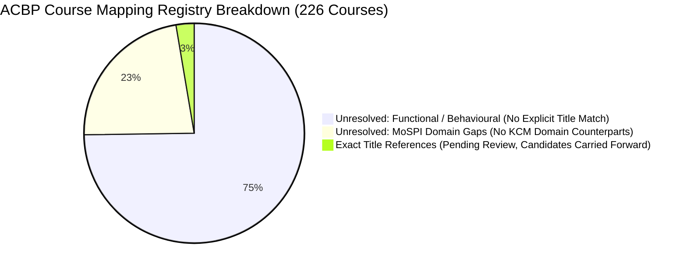

# Competency Mapping Registry & Review Queue: Implementation Specification

> **Document Status:** Implementation Baseline  
> **Milestone:** SIH26101 — Stage 3.2: Implement the Competency Mapping Registry  
> **Source Documents & Datasets:**  
> - `data/processed/competencies_kcm.json` (`SRC-CBC-KCM-2024`)  
> - `data/processed/acbp_courses.json` (`SRC-MOSPI-ACBP-2026-27`)  
> - `data/processed/acbp_kcm_candidate_mappings.json` (Stage 2B.2 Interim Baseline)  
> **Generated Artifacts:**  
> - `data/processed/acbp_kcm_mappings.json` & [`.csv`](file:///d:/Projects/SIH26101/SIH26101-Skill-Intelligence/data/processed/acbp_kcm_mappings.csv)  
> - `data/processed/acbp_kcm_review_queue.json` & [`.csv`](file:///d:/Projects/SIH26101/SIH26101-Skill-Intelligence/data/processed/acbp_kcm_review_queue.csv)  
> **Pipeline Version:** `3.2.2` (Hardened)  
> **Author:** Antigravity AI & SIH26101 Engineering Team  

---

## 1. Overview & Architectural Realization

In Stage 3.1, a rigorous, non-hallucinatory mapping framework and schema were designed. **Stage 3.2 operationalizes this design** by constructing:
1. The **Comprehensive Mapping Registry** representing the mapping status of all **226 MoSPI ACBP course allocations** across the 11 cadre levels.
2. The **Deterministic Human-Review Queue** that organizes all courses by triage priority, segregates domain gaps, and highlights missing curricular evidence.
3. The **Deterministic Validation Module** ([`scripts/validate_competency_mappings.py`](file:///d:/Projects/SIH26101/SIH26101-Skill-Intelligence/scripts/validate_competency_mappings.py)) enforcing all 10 schema and integrity constraints.
4. The **Safe Review CLI Workflow** ([`scripts/review_mapping.py`](file:///d:/Projects/SIH26101/SIH26101-Skill-Intelligence/scripts/review_mapping.py)) supporting audited state transitions without data loss.

---

## 2. Input Baseline Hashes & Verification

In accordance with strict repository governance rules, all input datasets were audited prior to execution and remained bit-for-bit immutable throughout the pipeline:

| Dataset | Relative Path | Cryptographic SHA-256 Hash | Status |
| :--- | :--- | :--- | :--- |
| **KCM Baseline** | `data/processed/competencies_kcm.json` | `9106ec27631dd0894f7b59133734266d7e9fd19ba0ef94107c082b6b32c90fd4` | Verified Immutable |
| **ACBP Courses** | `data/processed/acbp_courses.json` | `ec6ec89a68cb0bc3aecb777f00a156cda1898d2392b5fd2a7a09cc1e8fe159e7` | Verified Immutable |
| **Candidate Mappings** | `data/processed/acbp_kcm_candidate_mappings.json` | `966cabebbcc02f5cc96f5879fdbe3c7af126adfdf57ad5c5219aae580656b801` | Verified Immutable |

---

## 3. Mapping Registry Architecture & Structure

The registry is materialized at [`data/processed/acbp_kcm_mappings.json`](file:///d:/Projects/SIH26101/SIH26101-Skill-Intelligence/data/processed/acbp_kcm_mappings.json) and exported to CSV with 100% value parity.

### 3.1 Registry Ledger Summary

```text
Total Evaluated Courses:          226
Mapped / Candidate Records:       6 (all pending_review, confidence_score = null)
Unresolved Records:               220
  - Official Domain Gaps:         51 (MoSPI Official Statistics / specialized domains)
  - Unresolved Functional/Beh:    169 (No explicit title reference in source text)
Validated Records:                0 (Zero unapproved / simulated validations)
Rejected Records:                 0 (Preserved for negative audit trails when rejected)
```

### 3.2 Explicit Breakdown by Mapping Method



1. **`exact_title_reference` (6 Records):**  
   The six candidate linkages from Stage 2B.2 (`ACBP-CRS-017`, `036`, `040`, `041`, `060`, `061`) are carried forward strictly under `pending_review`. All subjective confidence floats (`0.85`, `0.90`) have been removed and replaced with `null`, reflecting the reality that lexical similarity is not statistical probability.
2. **`unresolved_domain_gap` (51 Records):**  
   Every one of the 51 MoSPI Domain courses (e.g. *Overview of Basic Statistics*, *PM Gatishakti*, *Index Numbers*) is segregated. These are not failures of extraction; they reflect the institutional fact that the CBC KCM baseline contains zero domain competencies.
3. **`unresolved_no_match` (169 Records):**  
   Functional and Behavioural courses lacking explicit title matches are cataloged with explicit rationale noting that modular iGOT course syllabi are required to establish learning-outcome alignment.

---

## 4. Human-Review Queue Architecture

The review queue at [`data/processed/acbp_kcm_review_queue.json`](file:///d:/Projects/SIH26101/SIH26101-Skill-Intelligence/data/processed/acbp_kcm_review_queue.json) provides human curators with an actionable triage interface:

| Queue Category | Record Count | Triage Priority | Recommended Review Action |
| :--- | :---: | :---: | :--- |
| `title_reference_candidate` | **6** | **High** | Audit course syllabus against KCM sub-themes to determine if candidate should be promoted to `curated_candidate` or `rejected`. |
| `unresolved_no_match` | **169** | **Medium** | Acquire iGOT modular curriculum outline to perform semantic and curricular comparison in Stage 3.3+. |
| `unresolved_domain_gap` | **51** | **Low** | Await publication and integration of official MoSPI/NSSTA Domain Competency Dictionary under Stage 4. |

---

---

## 5. Safe Review CLI Operation (`review_mapping.py`)

A dedicated command-line workflow was created to support safe status transitions.

### 5.1 Permitted Transitions State Machine
- `unresolved` $\rightarrow$ `promote_to_curated` (requires `--kcm-id` and `--rationale`)
- `pending_review` $\rightarrow$ `promote_to_curated` (curator refines rationale)
- `pending_review` $\rightarrow$ `validate` (requires `--reviewer-id`, `--reviewer-role`, and `--rationale`)
- `pending_review` $\rightarrow$ `reject` (requires `--rationale`; record is **retained**, never deleted)
- `pending_review` $\rightarrow$ `mark_unresolved` (returns to unresolved when evidence is inconclusive)

### 5.2 Unambiguous Mapping Identifier Requirement (LIM-01 Resolution)
Per Stage 3.2.2 hardening, review operations strictly require an unambiguous primary key `mapping_id` (`MAP-ACBP-KCM-XXX`). Passing a course ID (`ACBP-CRS-XXX`) is explicitly rejected because courses may receive multiple candidate mappings in future pipeline stages.

```powershell
# 1. Inspect / Dry-run validation of a candidate using unambiguous mapping_id
python scripts/review_mapping.py --mapping-id MAP-ACBP-KCM-040 --action validate --reviewer-id "faculty_sme" --reviewer-role "NSSTA Faculty" --rationale "Verified that module syllabus addresses Indic governance and strategic leadership indicators." --dry-run

# 2. Reject an over-broad mapping (safe audit retention)
python scripts/review_mapping.py --mapping-id MAP-ACBP-KCM-036 --action reject --reviewer-id "faculty_sme" --reviewer-role "NSSTA Faculty" --rationale "Course duration is 36m and covers basic leadership; does not satisfy KCM-FUNC-05 technical project planning and PERT/CPM indicators."

# 3. Promote an unresolved course to curated candidate
python scripts/review_mapping.py --mapping-id MAP-ACBP-KCM-008 --action promote_to_curated --kcm-id "KCM-FUNC-19" --rationale "Disciplinary inquiry rules directly map to Vigilance Administration sub-theme on Conduct Rules (p. 99)."
```

### 5.3 Prototype Operational Disclaimer
The CLI tool explicitly outputs the following institutional limitation on execution:
```text
---------------------------------------------------------------------------
[PROTOTYPE AUDIT NOTICE]
Command-line reviewer credentials are simulated for prototype verification
and lack cryptographically verifiable institutional SSO/OAuth federation.
Formal production validation requires authenticated MoSPI/NSSTA/CBC identity assertion.
---------------------------------------------------------------------------
```

---

## 6. How to Reproduce & Validate (Hardened Workflow)

### 1. Build or Refresh Mapping Registry & Review Queue (LIM-02 Resolution)
```powershell
# Refreshes the registry while strictly preserving human review decisions, rejections, and rationales
python scripts/build_mapping_registry.py --merge-existing

# Or re-initialize from scratch with mandatory automated backup archiving
python scripts/build_mapping_registry.py --init-clean --create-backup
```
*Safety Note:* Executing `build_mapping_registry.py` without flags halts with code 1 by design if the registry already exists, preventing accidental overwrite of human review decisions.

### 2. Execute Deterministic Validation
```powershell
python scripts/validate_competency_mappings.py
```

### 3. Run Automated Pytest Regression Suite
```powershell
python -m pytest -v
```
*(All 82 automated test fixtures passing)*
